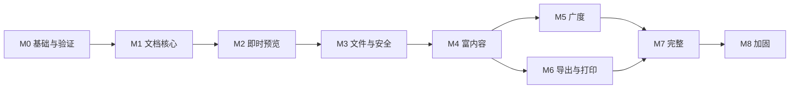

# 路线图

本页给出工作顺序与每个里程碑的退出条件，不是日期承诺。实际进度只在 GitHub Projects 中跟踪；里程碑与 GitHub Milestones 一一对应。

## 原则

- 安全优先：在扩展功能广度之前，先完成数据保护（保存、恢复、冲突、多窗口）。
- 每个里程碑以可运行的构建、通过的验收场景与向量、更新后的文档为退出条件。
- 滚动规划：所有里程碑及其按区域划分的史诗（epic）Issue 一开始就创建；只有当前与下一里程碑拆分为约一个 PR 大小的任务 Issue，其余里程碑在开始时按本页范围拆分。
- 预览与签名遵循[发布](release.md#版本与签名)。

## 里程碑

| 里程碑 | 目标 | 范围 | 退出条件 |
|---|---|---|---|
| M0 基础与验证 | 让工程与关键技术路线可验证 | CI 在三平台通过；`xtask` 的 `layers`、`docs`、`vectors`、`trace` 检查；`moino_testkit` 的向量加载与受控时钟；技术验证：`editor_host` 即时预览原型与 Windows 输入法、Kit `Editor` 原位挂载无跳动、RaTeX 在 GPUI 中绘制、merman 渲染、Typst PDF（中日韩、孤行寡行、表头重复、书签、编译耗时与体积）、hayro 预览、原生装饰 + Alt 菜单栏、单实例 IPC、编辑区无障碍文本暴露 | 验证结果在 Issue 中记录；有效结论直接融入契约，未决边界明确说明 |
| M1 文档核心 | 无界面的文档内核 | `moino_text`（缓冲、偏移单位、字素与换行）、`moino_markdown`（CST、增量解析、全部扩展、一致性测试、差分模糊测试）、`moino_document`（事务、选择映射、历史、脏状态）、`moino_editing`（Enter / Backspace / Tab、语法转换、格式命令、自动配对） | 解析、编辑、历史、选择 的文本向量在无界面测试中通过；满足[核心覆盖率](testing.md#ci-门禁) |
| M2 即时预览 | 可交互的编辑表面 | 块投影与 `editor_host` 渲染、输入与输入法、插入点与选择绘制、标记展开、虚拟化与滚动锚点、`moino_theme` 与墨绿主题族、随包字体、状态栏、源码模式 | 编辑向量在 GPUI 测试中通过；Windows 输入法手动验证通过 |
| M3 文件与安全（0.1 预览） | 可以放心日常使用 | 编码与换行、原子保存、自动保存与恢复中心、外部冲突与三方合并、关闭与退出、单实例与多窗口租约、侧栏文件树 / 列表 / 大纲、快速打开、查找替换、设置分层、界面语言、菜单、文件操作与撤销、文件监视 | 保存、恢复、会话、工作区、文件系统、搜索 场景与故障注入通过 |
| M4 富内容（0.2 预览） | 完整的 Markdown 内容 | 表格、代码块、图片附件与链接、HTML 安全子集与媒体卡片、数学与编号、脚注、文内目录、提示块、文档元数据、剪贴板与拖放、自动补全 | 表格、代码块、图片、HTML、数学、剪贴板、大纲 场景通过 |
| M5 广度（0.3 预览） | 补齐编辑体验 | 图表、拼写检查与词典、专注 / 打字机 / 缩放 / 锁定、非 Markdown 预览、统计、工作区内容搜索、便携文档容器 | 图表、拼写、显示模式、文件格式 场景通过 |
| M6 导出与打印（0.4 预览） | 全部输出格式 | 语义中间表示与 JSON、HTML、PDF / PNG / JPEG、DOCX / ODT / EPUB / RTF / 纯文本 / Markdown 方言、导入、打印适配、导出配置 | 导出、语义中间表示、导入 场景通过，真实样本验证 |
| M7 完整（0.5 候选） | 功能完整 | 完整设置页面、主题管理与覆盖、高对比、编辑区无障碍、快捷键自定义、上传配置与凭据、外部处理、安全模式、命令行参数 | 全部功能契约有实现，无障碍、国际化、设置、命令、主题 场景通过 |
| M8 加固（1.0） | 达到发布门槛 | 性能与资源预算、故障注入、三平台完整验收、安全审查、打包、签名与公证、用户指南 | [发布门槛](release.md#发布门槛)全部满足 |

## 依赖关系

M5 与 M6 只依赖 M4，可以并行推进。
